<p align="center">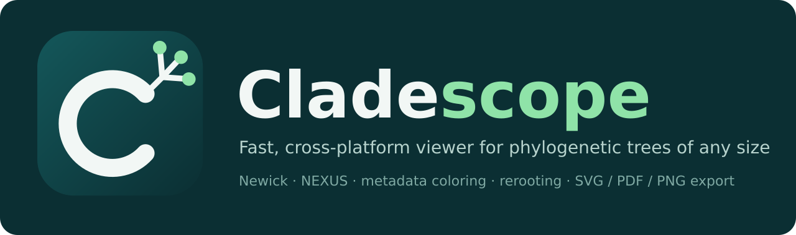</p>

# Cladescope

**A fast, cross-platform desktop viewer for phylogenetic trees of any size.**

Cladescope opens Newick and NEXUS trees from a handful of tips to tens of thousands, keeps them responsive with level-of-detail rendering, and lets you color, search, root, extract and export without leaving the window.

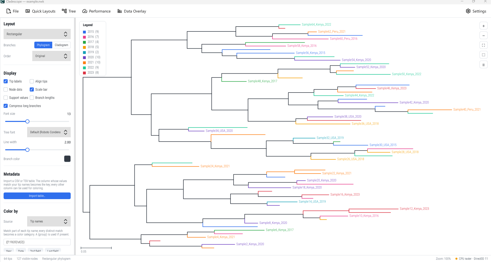

## Features

- **Large trees**: level-of-detail drawing keeps big trees responsive, with an optional GPU-accelerated canvas (OpenGL) and an automatic CPU fallback. Rectangle zoom and pan.
- **Layouts**: rectangular, slanted, circular and radial (unrooted), as phylograms or cladograms, from the Quick Layouts menu or the sidebar.
- **Formats**: Newick and NEXUS (including `translate` blocks, bracketed comments and scientific-notation branch lengths).
- **Coloring**: by regular expression on tip names, or by an imported metadata column. Or color by hand: drag a box around tips (the select tool, or Ctrl/Cmd+drag), click **Color…**, pick a swatch. Search matches can be picked and colored the same way. Turn on **Fill label background** to color a band behind the labels instead (as in poster figures). Hand colors appear in the legend and in every export.
- **Metadata import**: CSV/TSV; the column that best matches the tip names is used as the key automatically.
- **Branch support**: shows bootstrap or posterior values from numeric node labels, IQ-TREE style labels such as `87.5/99`, and BEAST/MrBayes `[&posterior=…]` annotations.
- **Search** for tips, and a choice of ten label fonts.
- **Editing**: reroot on a branch, midpoint rooting, extract a clade (optionally into a new window), highlight clades, undo (last 10 edits).
- **Axis break** for trees dominated by a single very long branch, so the rest of the tree stays readable.
- **Export**: SVG, PDF and PNG figures, optionally including the current selection.

## Gallery

Screenshots of Cladescope in use. Click an image to see it at full size.

| | |
|---|---|
| [](docs/screenshots/01-rectangular-color-by-year.png)<br>**Rectangular phylogram**, colored by a pattern on the tip names, with an automatic legend. | [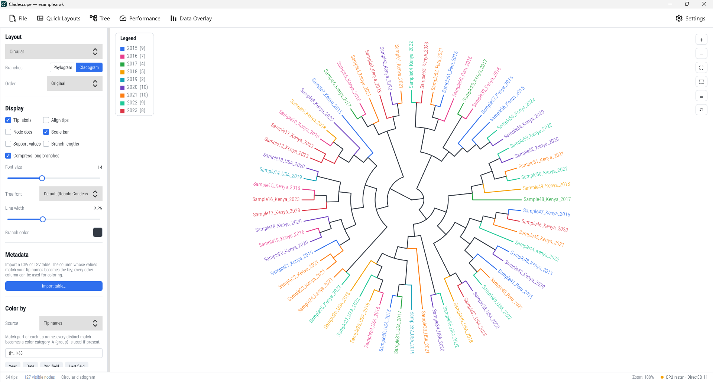](docs/screenshots/02-circular-color-by-year.png)<br>**Circular layout** of the same tree: one click in the layout menu. |
| [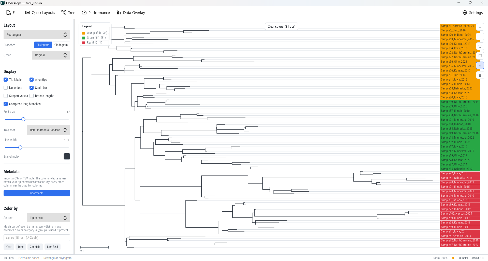](docs/screenshots/03-manual-color.png)<br>**Color by hand**: box-select tips, then pick a color. | [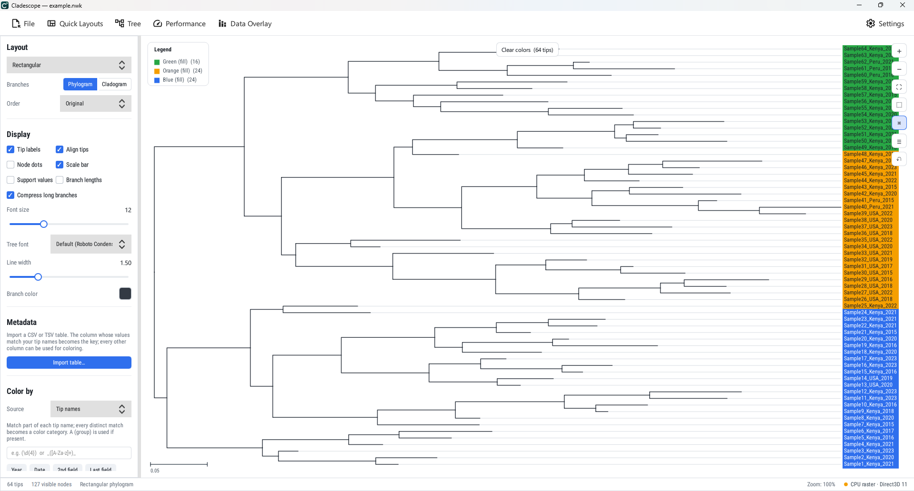](docs/screenshots/030-manual-color.png)<br>**Hand colors** shown in the legend and kept in exports. |
| [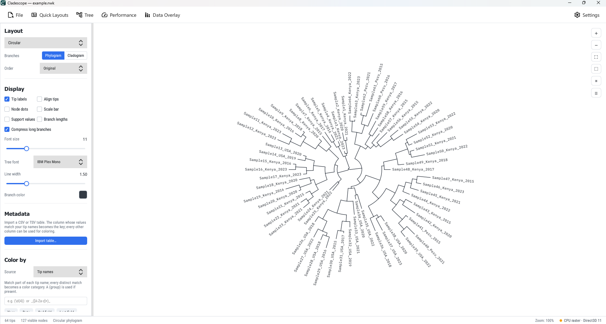](docs/screenshots/04-circular-with-new-fonts.png)<br>**Ten label fonts** to choose from. | [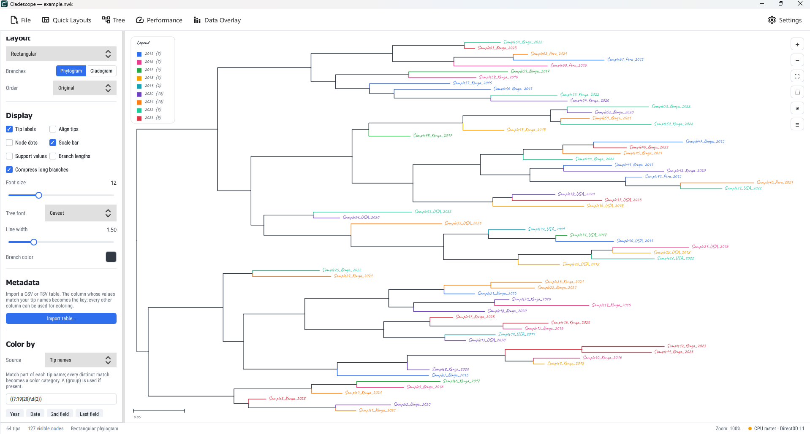](docs/screenshots/05-automatic-grouping.png)<br>**Automatic grouping** of tips from a pattern. |
| [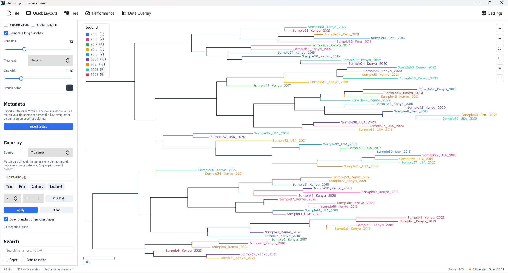](docs/screenshots/050-automatic-grouping-year.png)<br>**Group by year**, picked from the tip names. | [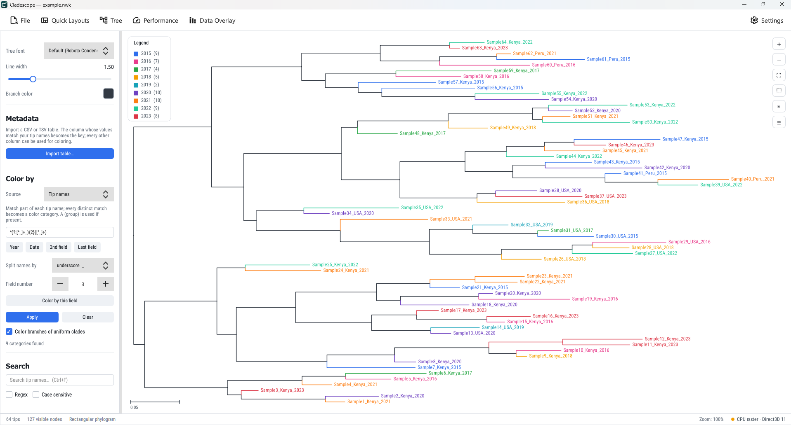](docs/screenshots/051-automatic-grouping-split-by-field.png)<br>**Split names by a delimiter** and color by a chosen field. |
| [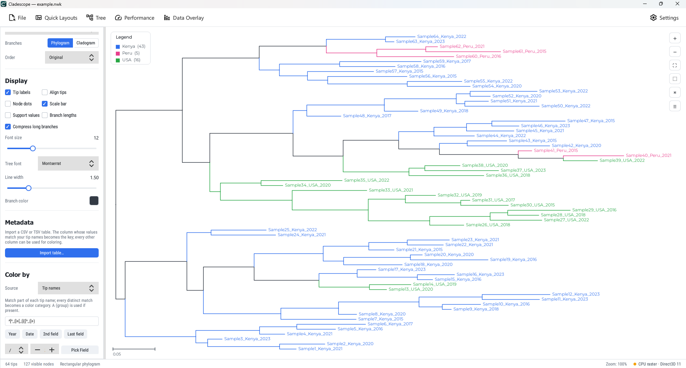](docs/screenshots/06-automatic-grouping-by-2nd-field-location.png)<br>**Group by the second field** (here the location). | [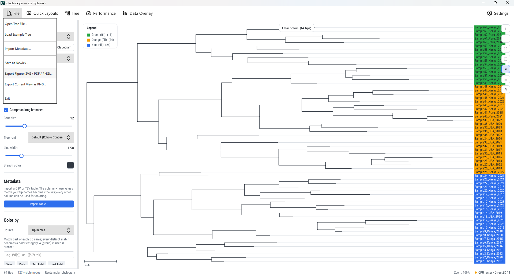](docs/screenshots/060-export-as-figure-svg-pdf-png.png)<br>**Export figures** as SVG, PDF or PNG. |

<!-- Animated demos: large GIFs are best attached to the v0.1.0 release (or a GitHub issue/PR comment) and linked here, not committed to the repo. -->

## Install

Download the package for your system from the [Releases page](../../releases):

| System | File | Notes |
|---|---|---|
| Windows | `Cladescope-<version>-windows-x64.zip` | Unzip and run `cladescope.exe`. |
| macOS | `Cladescope-<version>-macos.dmg` | Not code-signed: right-click the app and choose Open the first time. |
| Linux | `Cladescope-<version>-linux-x86_64.AppImage` | `chmod +x` it and run. |

**macOS:** Cladescope isn't notarized yet. After dragging it to Applications, run
`xattr -dr com.apple.quarantine /Applications/Cladescope.app` once, or open
System Settings → Privacy & Security and click **Open Anyway**.

Verify downloads with `SHA256SUMS.txt` from the same release.

## Build from source

Requirements: Qt 6.10 or newer (Quick and Svg modules), CMake 3.16+, a C++17 compiler.

```bash
cmake -S . -B build -DCMAKE_BUILD_TYPE=Release
cmake --build build --parallel
./build/bin/cladescope         # on Windows: build\Release\cladescope.exe
```

## Usage

Open a tree with **File → Open Tree File…**, drag it onto the window, or start the program with a file path (**File → Load Example Tree** gives you something to try). Import a metadata table with **File → Import Metadata…** and pick a column under **Color by**. **File → Export Figure** writes SVG, PDF or PNG. Rerooting, extracting a clade and highlighting are in the **Tree** menu, and Ctrl+Z undoes the last edit.

## Tests

```bash
cd tests/js && npm run test      # logic tests, no Qt needed
cmake -S . -B build -DCLADESCOPE_BUILD_TESTS=ON && cmake --build build && ctest --test-dir build --output-on-failure
```

See [tests/README.md](tests/README.md).

## Citing

Use the "Cite this repository" button on GitHub (it reads `CITATION.cff`). A Zenodo DOI will be added here with the first release.

## Contributing and license

Bug reports and pull requests are welcome; see [CONTRIBUTING.md](CONTRIBUTING.md). Released under the [MIT license](LICENSE).